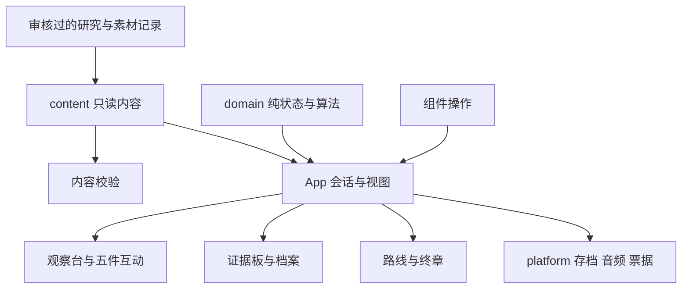

# 长征失物招领处：总体架构与实施入口

## 1. 当前交付与权威顺序

项目已选定《长征失物招领处：为无名者保存一件东西》。本轮交付是架构、开发契约、内容与素材规范、实读资料台账；尚未创建应用、安装依赖、制作最终物件图或运行产品。下文的`app/`为后续实施目标，不是已存在代码。

阅读顺序：

| 文档 | 解决的问题 |
| --- | --- |
| [比赛要求](比赛要求.md) | 比赛规则、评分、提交与说明书栏目 |
| 本文 | 产品范围、模块职责、技术决策、目录与运行方式 |
| [02数据与状态契约](02数据与状态契约.md) | 内容类型、状态、事件、持久化与边界校验 |
| [03交互与视觉](03交互与视觉.md) | 页面、五件互动、响应式、无障碍和录屏 |
| [04内容与素材规范](04内容与素材规范.md) | 史实、叙事、教学模型与素材审核 |
| [05开发任务与验收](05开发任务与验收.md) | 实施顺序、文件所有权、质量门槛与交付 |
| [研究：历史背景与日常物件](research/01历史背景与日常物件.md) | 实际阅读的历史来源、事实候选与边界 |
| [研究：通信技术与素材来源](research/02通信技术与素材来源.md) | 通信史、模型边界、形制与许可入口 |
| [06游戏剧情流程](06游戏剧情流程.md) | 玩家直接调查的照应任务、物件线索、完整谜底与顺序适配 |

用户明确要求与比赛规则优先；数据和事件以02为准，界面以03为准，发布内容以04的审核记录为准。原提案中的后端、联网统计、四件/五件范围差异、按证据数量判真和“经历真实”结语已由本套规范明确取舍。变更契约由集成负责人同步所有受影响文档和调用方，不建立兼容接口。

## 2. 完整产品范围

玩家直接在虚拟档案工作台调查五件数字叙事物件，不设现代主角或NPC对白。主循环为“审视—展开/辨读—比对—建档”，标记与辅助记录串起一项长征途中照应任务。玩家要查清改点、分批、领料补鞋与最终接收的经过，区分故事内结论、历史背景及仍未知的身份；完整剧情以06为准。

| 物件ID | 场景题材 | 主要互动 |
| --- | --- | --- |
| list | 湘江背景下的原创转送名单 | 三片旋转拼合、清理、辨字；查任务栏、状态图例与回执裁口 |
| map | 遵义与四渡赤水背景；另附原创接应小示意 | 翻面展开折纸，沿箭头查旁注与前后批记录；四渡作为可选背景阅读 |
| battery | 通信器材示意物件，设计名“电池盒” | 审视固定带接头与背带裁口，读器材交接与领料记录 |
| shoes | 雪山草地背景下的原创草鞋 | 审视鞋底旧补料，展开领用联并与盒内记录对照 |
| bowl | 生活器具与会师背景；原创留饭交接物件 | 双记号拓印、回执与前四件核对，确认任务结果 |

前三件与草鞋全靠审视物件、读取记录和保留判断推进，不设连通、排序、步伐或修补练习；名单保留拼合清理，饭碗保留拓印，共两个小游戏。玩家用放大、翻面和并排对照查看细节，用一个主要动作完成每件的调查。

前四件自由进入且可独立建档；完成其中任意三件后解锁饭碗的观察与互动，饭碗最终判断所需的四份关联资料分别依赖前四件建档，齐备后才能完成饭碗建档。五件完成后解锁终章，先回看已还原的事件，再任选一件、填写不超过50个Unicode字符的陈列说明并下载PNG票据，文字可空且只留本地。所有物件可回看、重做；不设倒计时、思想分数或实名物主答案。姓名可以未知，事件不能以未知代替结局。

完整体验目标12—15分钟，实际耗时由试玩测得，不作为强制计时。来源、虚构说明、声音设置始终可达；重要录音必须有字幕，关闭声音不影响完成。

## 3. 技术决策与取舍

| 层面 | 采用方案 | 理由与边界 |
| --- | --- | --- |
| 应用 | Vue 3、TypeScript、Vite，客户端静态单页 | 沿用原提案的Vue方向，五件共用观察与建档界面；不需服务端渲染 |
| 页面 | 单一App视图状态，组件切换 | room、case、ending三个视图，无深链需求；不引入路由 |
| 会话 | App层一个Vue reactive对象，统一dispatch；向下传只读props与事件 | 状态和动作集中；五个模块不得各自建全局store或直接写存档 |
| 内容 | 本地TypeScript只读数据＋构建前校验 | 人工审核，核心内容不依赖接口；不做内容管理平台 |
| 绘图 | 原生SVG、Canvas、CSS与多角度二维图 | SVG用于地图/线路，Canvas用于清理、拓印与票据，CSS仅必要反馈 |
| 样式 | 全局CSS变量＋组件scoped CSS | 一套主题，统一焦点和排版；不增加预处理器或组件库 |
| 声音 | 原生HTMLAudioElement，统一播放管理 | 用户触发后播放，字幕可读；音频不是进度门槛 |
| 存档 | 有版本的localStorage，JSON导入/导出 | 离线继续，存储异常时保持内存并提供手动备份；详见02 |
| 票据 | Canvas绘制文字与已授权本地图，导出PNG | 不依赖页面截图库；多行文本与字体完成后绘制 |
| 验证 | vue-tsc、Vitest、内容校验、浏览器实操 | 构建成功不等于类型或产品正确；永久测试针对边界与状态行为 |
| 发布 | Vite的dist静态产物，HTTP本地运行与静态托管 | 所有必要内容、图片、音频随包提供；原文外链是唯一可选外网访问 |

本阶段选定静态应用与本地进度，不做FastAPI、数据库、账号、遥测、匿名统计、云存档与网络恢复补交。原提案的在线访问保留：同一静态产物可以托管，浏览器进度仍保存在访问来源的本地存储中；跨设备与跨域不共享进度。后端不是本届核心体验的前提。

应用运行依赖仅`vue`；开发依赖为Vite、Vue插件、TypeScript、vue-tsc、Vitest及所需类型。初始化时选兼容的稳定版本并提交package-lock.json，具体版本不在未安装时伪造。禁止为了图表、动画、票据或几个状态字段引入额外通用框架。

## 4. 模块与依赖边界



- `domain/`只依赖类型与数据参数，不读取Vue、DOM、localStorage、音频或网络。
- `content/`只存事实、场景、命题、解读、引用与资源索引，不写操作状态，不动态生成史实。
- `platform/`负责浏览器副作用，不判断历史结论、不决定解锁；所有失败返回可处理结果。
- `features/`通过props读取当前内容/状态，通过emit发02定义的事件；临时拖动、缩放和焦点可留组件本地。
- `App.vue`是集成所有者：dispatch、选择器、存档时机、弹窗、全局音频与视图切换；组件不import完整content偷偷改对象。
- `shared/`仅放实际复用的来源弹窗、状态提示与基本按钮样式，不建立泛用动态表单/插件引擎。

## 5. 实施目录目标

下列应用路径在后续开发时创建，不预先建立空实现或占位页面。

```text
app/
  package.json
  package-lock.json
  index.html
  vite.config.ts
  tsconfig.json
  public/assets/{list,map,battery,shoes,bowl,shared}/
  src/
    main.ts
    App.vue
    styles/tokens.css
    domain/
      model.ts
      session.ts
      selectors.ts
      validateContent.ts
      puzzles/{list,map,battery,shoes,bowl}.ts
      session.test.ts
      puzzles/*.test.ts
    content/
      sources.ts
      assets.ts
      history.ts
      cases/{list,map,battery,shoes,bowl}.ts
      archive.ts
    platform/
      storage.ts
      audio.ts
      ticket.ts
      storage.test.ts
    features/
      room/ArchiveRoom.vue
      inspector/ObjectInspector.vue
      evidence/EvidenceBoard.vue
      archive/ArchiveReview.vue
      ending/EndingPanel.vue
      puzzles/{ListPuzzle,BowlPuzzle}.vue
    shared/{SourceDialog,NoticeRegion}.vue
```

资料台账与可编辑图形源稿留在`docs/`的研究与素材记录中；产出的可发布素材才进入`app/public/assets/`。禁止把未授权原图、带真实身份的数据、研究中未解决的猜测或测试夹具混入正式产物。

## 6. 团队工作体系

指定一名集成负责人拥有App、契约、依赖、全局样式和最终交付；内容负责人拥有事实、命题和素材登记；互动开发负责人拥有纯算法与对应界面。人少时合并职责，不增加组织层级。

每个变更说明解决的用户问题、涉及文件、内容依据、实际验证与剩余风险。契约变更先登记影响面并同步调用方；内容变更核查解锁、来源与反馈。提交采用`feat`、`fix`、`docs`、`test`、`chore`的简短主题；不自动创建远端仓库或发布。

质量门槛分三层：事实/素材有可追溯依据；类型/内容/行为检查通过；真实浏览器能走完整五件与终章。流程详见05，不能以内部样板、占位素材或模拟录屏代替最终作品。

## 7. 环境与运行边界

本次实测本机Node为`v26.11.1`。Vite当前官方页面列出Node 20.19+、22.12+的基础要求，同时提醒模板可能更高；安装时仍需核对实际依赖兼容性。本轮未安装包，也未证明当前Node能运行未来锁定的依赖；不改全局环境。

本地离线运行是断外网后通过本地HTTP服务访问已构建产物，不承诺双击HTML、不承诺未缓存的远端网站离线首次打开。开发依赖安装本身通常需网络，提交包应包含dist与明确本地服务说明。Vite preview仅用于本地核验，不作为正式生产服务器。

`base`选择`./`并实际核验子目录资源；字体与音频不使用外部CDN。部署前验证路径、资源、存档和票据，任何外部发布或比赛发送由用户另行决定。

## 8. 本轮技术依据

本次使用context7-mcp查询Vue文档，服务返回月度配额耗尽，改为实读官方正文：

- [Vue状态管理](https://vuejs.org/guide/scaling-up/state-management.html)：允许简单场景集中响应式状态与动作；本文采用客户端单实例，不应用于SSR共享请求。
- [Vue与TypeScript](https://vuejs.org/guide/typescript/overview.html)：Vite只转译，不执行类型检查，SFC需vue-tsc。
- [Vite入门](https://vite.dev/guide/)：运行环境与Vue/TypeScript模板。
- [Vite静态发布](https://vite.dev/guide/static-deploy.html)：dist、base与preview边界。

以上查阅于2026-10-14。架构决策不是已运行结果；历史研究和授权状态单独在research登记。
